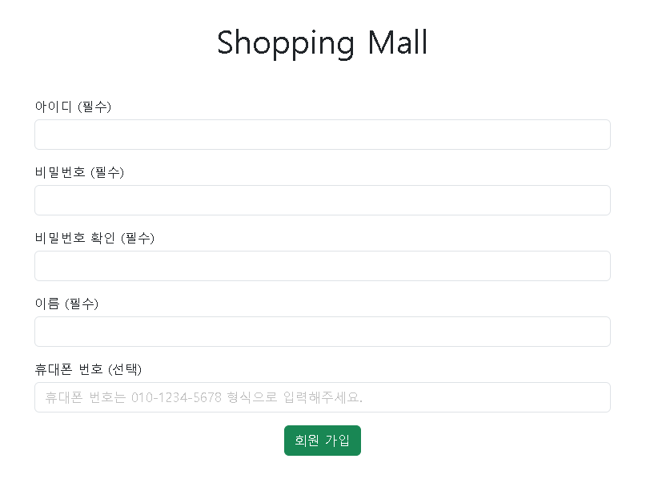
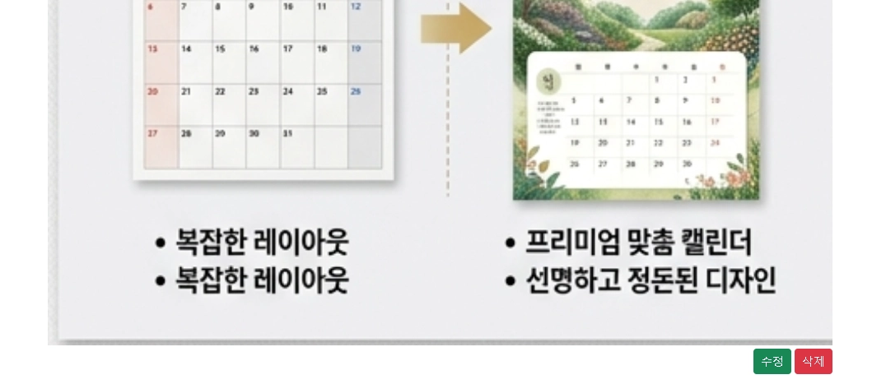

# README

# 1. 프로젝트 소개

- 쇼핑몰 사이트를 만드는 프로젝트이다.
- 회원, 상품, 주문, 장바구니 도메인으로 구성되어 있다.
- 단순 게시판 프로젝트보다 복잡한 도메인 엔티티 간의 관계를 설계하고 구현하는 경험을 위한 프로젝트

# 2. 기술 스택

### Backend

- Spring Boot
- Spring MVC
- JPA / Spring Data JPA
- Spring Security
- Spring Validation

### Frontend (Server-Side Rendering)

- Thymeleaf
- Bootstrap

### Database

- MySQL

### Test

- JUint (JUnit5)

# 3. 주요 기능

## 1. 회원

### 01. 회원 가입



- 아이디, 비밀번호, 이름, 휴대폰 번호(선택) 등의 정보를 입력하고 회원 가입


- 필수 정보 미입력 시 알림 메시지 노출


- 회원 아이디 중복 검사 수행

### 02. 로그인


- 아이디와 비밀번호 입력 후 로그인


- 아이디 또는 비밀번호가 틀리면 알림 메시지 노출

### 03. 로그아웃


- 로그인 후 우측 상단에 로그아웃 버튼을 노출하며, 해당 버튼으로 로그아웃 가능

## 2. 상품

### 01. 상품 등록


- 관리자 계정으로 로그인 시 상품 등록 버튼 노출 (좌측 상단)


- 상품 등록에 필요한 정보를 입력하여 상품 등록 가능


- 필수 정보 미입력 시 알림 메시지 노출

### 02. 상품 수정


- 관리자 계정으로 로그인 시 상품 목록에서 각 상품별로 상품 수정 버튼이 있다.


- 각 상품의 기존 정보가 있으며, 수정 후 저장할 수 있다.




- 각 상품의 대표 이미지는 수정만 가능하며, 상세 설명 이미지는 수정 또는 삭제가 가능하다.


- 최종적으로 수정 완료 버튼을 통해 변경 사항을 적용할 수 있다.

### 03. 상품 삭제


- 관리자 계정으로 로그인 시 상품 목록에서 각 상품별로 삭제 버튼이 있다.
- 임의의 상품의 삭제 버튼을 누르면 상품 상태가 변경되며 삭제 처리된다.

### 04. 상품 목록 조회

#### 관리자


- 관리자 계정으로 로그인 시 상품 목록 페이지로 이동하며, 좌측 상단에 상품 목록으로 이동하는 버튼이 있다.

#### 일반 사용자/미인증 사용자


- 쇼핑몰에 접속하면 상품 목록 페이지가 바로 나온다.
- 미인증 사용자는 네비게이션 바에 로그인과 회원 가입 버튼이 노출된다.


- 로그인한 일반 사용자에게 네비게이션 바에 장바구니, 주문 내역, 로그아웃 버튼이 노출된다.
- 상품은 페이지네이션하여 전체 목록을 보여준다.

### 05. 상품 상세 조회


- 상품 목록에서 임의의 상품을 클릭하면 상품 상세 페이지 이동한다.
- 상품 상세 페이지에는 상품 대표 이미지, 상품명, 가격, 수량 선택 버튼, 장바구니 담기, 주문하기 버튼 등이 있으며, 아래에는 상품 상세 설명 이미지를 볼 수 있다.

## 3. 장바구니

### 01. 장바구니 담기


- 상품 상세 페이지에서 선택한 수량만큼 장바구니 담기 버튼을 통해 장바구니에 해당되는 상품을 담을 수 있다.

### 02. 장바구니 목록/장바구니 상품 수량 변경/장바구니 상품 삭제


- 장바구니 목록에서 현재 장바구니에 담긴 상품의 목록들을 확인 할 수 있다.
- 각 상품별로 장바구니에 담을 수량을 변경할 수 있다.
- 각 상품별로 장바구니에서 상품을 삭제할 수 있다.

## 4. 주문

- 주문 기능은 인증 사용자만 사용할 수 있다.

### 01. 장바구니 상품 주문/상품 상세 페이지 상품 주문

**장바구니 상품 주문**


- 장바구니에 상품을 담고 주문하기 버튼을 누르면 주문 페이지로 이동한다.


- 주문 페이지에서 필요한 정보를 입력하고 주문 버튼을 누르면 주문이 완료된다.
- 장바구니에 담긴 상품의 정보가 자동으로 주문 페이지에 입력된다.

**상품 상세 페이지 상품 주문**


- 임의의 상품 상세 페이지에서 수량을 선택하고 주문하기 버튼을 누르면 주문 페이지로 이동한다.


- 주문 페이지에서 필요한 정보를 입력하고 주문 버튼을 누르면 주문이 완료된다.
- 주문하기 버튼을 누른 상품 상세 페이지에 해당되는 상품과 수량의 정보가 주문 페이지에 자동으로 입력된다.

### 02. 주문 내역 조회


- 로그인 후 상단 네비게이션 바에 있는 주문 내역 버튼을 눌러 주문 내역 페이지로 이동한다.


- 주문 내역 페이지에서 각 주문의 대표 이미지, 대표 상품명, 총 주문 금액, 주문일 등의 정보를 확인할 수 있다.
- 주문은 최신순으로 정렬된다.

### 03. 주문 상세 조회


- 주문 내역 조회 페이지에서 각 주문별로 주문 상세 조회 버튼이 있으며, 버튼을 누르면 해당되는 주문의 상세 조회 페이지로 이동한다.


- 주문 상세 조회 페이지에 기본 주문 정보, 배송 정보, 주문 상품 정보 등이 있다.

### 04. 주문 취소


- 주문 상세 조회 페이지 우측 상단에 주문 취소 버튼이 있다.
- 현재는 결제 및 배송 도메인 등이 없어 버튼만 누르면 주문 취소가 가능하다.


- 주문 취소 후 주문 상세 내역 우측 상단에 주문 취소 표시가 뜬다.


- 주문 취소 후 주문 내역에도 취소된 주문에 대한 표시가 뜬다.

# 4. 실행 방법

### 1. 요구 환경

- Java 21
- Spring Boot 4
- Gradle 9.4
- MySQL 8.4

### 2. 프로젝트 클론

```bash
git clone https://github.com/hanulhaeka/shopping-mall.git
cd shopping-mall
```

### 3. 데이터베이스 생성

MySQL에 접속하여 데이터베이스를 생성합니다.

```sql
CREATE DATABASE shopping_mall;
```

### 4. 애플리케이션 설정

`src/main/resources/application.properties`에 다음 설정을 등록합니다.

```
# 데이터베이스 설정 정보
spring.datasource.url=jdbc:mysql://localhost:3306/shopping_mall?serverTimezone=Asia/Seoul&characterEncoding=UTF-8
spring.datasource.username=root
spring.datasource.password=<yourpassword>

spring.jpa.hibernate.ddl-auto=create

# 샘플 데이터 등록 설정
spring.sql.init.mode=always
spring.jpa.defer-datasource-initialization=true

# 상품 이미지 저장 폴더 경로
file.dir=<로컬에서 상품 이미지를 저장할 폴더의 절대 경로>

spring.jpa.properties.hibernate.default_batch_fetch_size=100
```

> **spring.jpa.hibernate.ddl-auto=create 설정으로 인해 실행 시마다 스키마를 새로 생성하니 주의**

### 5. 프로젝트 실행

macOS / Linux

```bash
./gradlew bootRun
```

Windows (CMD)

```bash
gradlew.bat bootRun
```

### 6. 브라우저에서 접속

[http://localhost:8080](http://localhost:8080/)

### 7. 로그인 (샘플 데이터)

관리자 계정

- id → admin
- password → 1234

일반 사용자 계정

- id → user
- password → 1234

# 5. 프로젝트 구조

```bash
shopping-mall/                                  # 프로젝트 루트 폴더
└── src/
    ├── main/
    │   ├── java/com/seungjig/shoppingmall/
    │   │   ├── cart/                           # 장바구니 도메인
    │   │   │   ├── controller/
    │   │   │   ├── entity/
    │   │   │   ├── repository/
    │   │   │   └── service/
    │   │   ├── global/
    │   │   │   ├── config/                     # 공통 설정
    │   │   │   ├── controller/                 # 홈 화면 컨트롤러
    │   │   │   ├── entity/                     # 생성일, 수정일 BaseEntity
    │   │   │   ├── exception/
    │   │   │   ├── security/                   # CustomUserDetailService,CustomUserDetails
    │   │   │   └── util/                       # 파일 처리 (저장, 삭제) 클래스
    │   │   ├── order/                          # 주문 도메인
    │   │   │   ├── controller/
    │   │   │   ├── entity/
    │   │   │   ├── exception/
    │   │   │   ├── repository/
    │   │   │   └── service/
    │   │   ├── product/                        # 상품 도메인
    │   │   │   ├── controller/
    │   │   │   ├── entity/
    │   │   │   ├── exception/
    │   │   │   ├── repository/
    │   │   │   └── service/
    │   │   ├── user/                           # 회원 도메인
    │   │   │   ├── controller/
    │   │   │   ├── entity/
    │   │   │   ├── exception/
    │   │   │   ├── repository/
    │   │   │   └── service/
    │   │   └── ShoppingMallApplication.java
    │   └── resources/
    │       ├── static/
    │       │   └── js/                         # js 정적 자원
    │       ├── templates/                      # 도메인별 타임리프 템플릿
    │       │   ├── cart/
    │       │   ├── order/
    │       │   ├── product/
    │       │   └── user/
    │       ├── application.properties
    │       └── data.sql
    └── test/                                  # 도메인별 통합/단위 테스트
        └── java/com/seungjig/shoppingmall/
            ├── cart/
            ├── order/
            ├── product/
            ├── user/
            └── ShoppingMallApplicationTests.java

```

# 6. 트러블 슈팅

[장바구니 상품 수량 변경 시 API 과호출 및 요청 순서 역전 문제 해결](./docs/troubleshooting/cart-api-debounce-and-order.md)

[주문 취소 요청 멱등성 보장 및 주문 상태와 재고 동시성 문제 해결 및 데드락 문제 예방](./docs/troubleshooting/order-cancel-idempotency-and-concurrency.md)

[참조 무결성 제약 조건을 고려한 상품 삭제 기능 구현(Soft Delete 도입)](./docs/troubleshooting/product-soft-delete.md)
