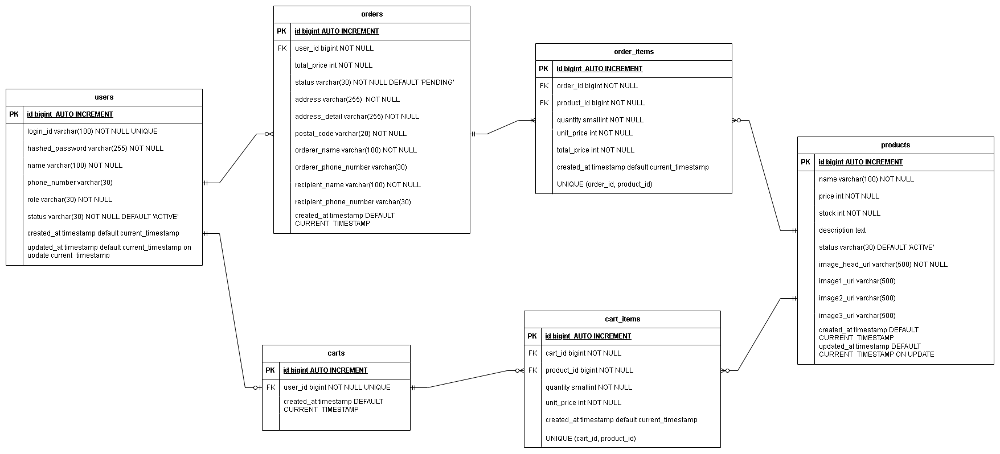

# ERD와 테이블 정의

# ERD

\*ERD는 설계 단계에서 초기에 작성한 내용임

\*컬럼 목록이나 타입, 제약 조건 등에 미세한 변경이 있을 경우에는 따로 수정하지 않음

\*테이블 자체나 큰 변화가 있을 경우에는 ERD도 수정

\*기본적으로 작은 변경들은 테이블 정의에서 수정 반영

# 테이블 정의

## Users

| 테이블 한글명 | 회원                                               |
| ------------- | -------------------------------------------------- |
| 테이블 영문명 | users                                              |
| 테이블 설명   | 쇼핑몰에 가입한 회원의 기본 정보를 저장하는 테이블 |

| No. | 논리명    | 컬럼명          | 데이터 타입  | PK  | FK  | NULL | 기본값            | UQ  | 설명                                  |
| --- | --------- | --------------- | ------------ | --- | --- | ---- | ----------------- | --- | ------------------------------------- |
| 1   | 회원ID    | id              | BIGINT       | O   |     | N    | AUTO_INCREMENT    | O   | 회원의 고유 식별자 (대리키)           |
| 2   | 로그인ID  | login_id        | VARCHAR(100) |     |     | N    |                   | O   | 회원이 로그인 시 사용하는 ID          |
| 3   | 비밀번호  | hashed_password | VARCHAR(255) |     |     | N    |                   |     | 회원이 로그인 시 사용하는 비밀버호    |
| 4   | 회원명    | name            | VARCHAR(100) |     |     | N    |                   |     | 회원의 실명                           |
| 5   | 전화번호  | phone_number    | VARCHAR(30)  |     |     | Y    |                   |     | 회원 명의의 휴대폰 번호               |
| 6   | 역할      | role            | VARCHAR(30)  |     |     | N    | ‘USER’            |     | 판매자와 일반 회원을 구분을 위한 역할 |
| 7   | 회원 상태 | status          | VARCHAR(30)  |     |     | N    | ‘ACTIVE’          |     | 회원 탈퇴 등의 경우에 회원 상태 변경  |
| 8   | 생성일    | created_at      | TIMESTAMP    |     |     | N    | CURRENT_TIMESTAMP |     | 회원 가입 시 시간을 저장              |
| 9   | 수정일    | updated_at      | TIMESTAMP    |     |     | Y    | CURRENT_TIMESTAMP |     | 데이터 수정 시 자동 갱신              |

## Orders

| 테이블 한글명 | 주문                                               |
| ------------- | -------------------------------------------------- |
| 테이블 영문명 | orders                                             |
| 테이블 설명   | 회원이 한 번 주문할 때 관련 정보를 저장하는 테이블 |

| No. | 논리명           | 컬럼명                 | 데이터 타입  | PK  | FK  | NULL | 기본값            | UQ  | 설명                                |
| --- | ---------------- | ---------------------- | ------------ | --- | --- | ---- | ----------------- | --- | ----------------------------------- |
| 1   | 주문ID           | id                     | BIGINT       | O   |     | N    | AUTO_INCREMENT    | O   | 주문 정보의 고유 식별자 (대리키)    |
| 2   | 회원ID           | user_id                | BIGINT       |     | O   | N    |                   |     | 해당 주문을 한 회원의 식별자        |
| 3   | 총 가격          | total_price            | INT          |     |     | N    |                   |     | 주문한 모든 상품의 총 합 가격       |
| 4   | 주문 상태        | status                 | VARCHAR(30)  |     |     | N    | ‘PENDING’         |     | 주문 취소 등에 따른 상태 변경       |
| 5   | 기본 주소        | address                | VARCHAR(255) |     |     | N    |                   |     | 도로명/지번 기반 주소 정보          |
| 6   | 상세 주소        | address_detail         | VARCHAR(255) |     |     | N    |                   |     | 건물명/동/호수 등의 상세 주소       |
| 7   | 우편 번호        | postal_code            | VARCHAR(20)  |     |     | N    |                   |     | 배송지 구역 식별 번호               |
| 8   | 주문자 이름      | orderer_name           | VARCHAR(100) |     |     | N    |                   |     | 주문을 한 사람의 이름               |
| 9   | 주문자 전화 번호 | orderer_phone_nuember  | VARCHAR(30)  |     |     | Y    |                   |     | 주문을 한 사람의 전화 번호          |
| 10  | 수신인 이름      | recipient_name         | VARCHAR(100) |     |     | N    |                   |     | 주문한 물건을 받는 사람의 이름      |
| 11  | 수신인 전화 번호 | recipient_phone_number | VARCHAR(30)  |     |     | Y    |                   |     | 주문한 물건을 받는 사람의 전화 번호 |
| 12  | 생성일           | created_at             | TIMESTAMP    |     |     | N    | CURRENT_TIMESTAMP |     | 주문한 시간 저장                    |
| 13  | 수정일           | updated_at             | TIMESTAMP    |     |     | Y    | CURRENT_TIMESTAMP |     | 주문 정보 수정 시간 저장            |

## Order_items

| 테이블 한글명 | 주문 상품                                            |
| ------------- | ---------------------------------------------------- |
| 테이블 영문명 | order_items                                          |
| 테이블 설명   | 한번의 주문에 포함된 상품들의 정보를 저장하는 테이블 |

| No. | 논리명          | 컬럼명      | 데이터 타입 | PK  | FK  | NULL | 기본값            | UQ  | 설명                                               |
| --- | --------------- | ----------- | ----------- | --- | --- | ---- | ----------------- | --- | -------------------------------------------------- |
| 1   | 주문 상품ID     | id          | BIGINT      | O   |     | N    | AUTO_INCREMENT    | O   | 주문에 포함된 상품 정보의 고유 식별자 (대리키)     |
| 2   | 주문ID          | order_id    | BIGINT      |     | O   | N    |                   |     | 어떤 주문에 포함된 상품인지 식별하기 위한 외래키   |
| 3   | 상품ID          | product_id  | BIGINT      |     | O   | N    |                   |     | 어떤 상품인지 식별하기 위한 외래키                 |
| 4   | 상품 수량       | quantity    | SMALLINT    |     |     | N    |                   |     | 주문에 포함된 특정 상품의 수량                     |
| 5   | 상품 가격       | unit_price  | INT         |     |     | N    |                   |     | 주문에 포함된 상품 하나의 가격                     |
| 6   | 상품 가격 총 합 | total_price | INT         |     |     | N    |                   |     | 상품 하나의 가격에 해당 상품의 주문 수량을 곱한 값 |
| 7   | 생성일          | created_at  | TIMESTAMP   |     |     | N    | CURRENT_TIMESTAMP |     | 주문한 시간 저장                                   |
| 8   | 수정일          | updated_at  | TIMESTAMP   |     |     | Y    | CURRENT_TIMESTAMP |     | 주문 상품 정보 수정 시간 저장                      |

| 제약조건명                    | 유형        | 구성 컬럼            | 설명                                  |
| ----------------------------- | ----------- | -------------------- | ------------------------------------- |
| UK_ORDER_ITEMS_PRODUCT_UNIQUE | 복합 UNIQUE | order_id, product_id | 주문에서 동일한 상품의 중복 저장 방지 |

## Products

| 테이블 한글명 | 상품                                                  |
| ------------- | ----------------------------------------------------- |
| 테이블 영문명 | products                                              |
| 테이블 설명   | 쇼핑몰에서 구매할 수 있는 상품 정보를 저장하는 테이블 |

| No. | 논리명           | 컬럼명         | 데이터 타입  | PK  | FK  | NULL | 기본값            | UQ  | 설명                                                       |
| --- | ---------------- | -------------- | ------------ | --- | --- | ---- | ----------------- | --- | ---------------------------------------------------------- |
| 1   | 상품ID           | id             | BIGINT       | O   |     | N    | AUTO_INCREMENT    | O   | 상품 정보의 고유 식별자 (대리키)                           |
| 2   | 상품명           | name           | VARCHAR(100) |     |     | N    |                   |     | 상품 이름                                                  |
| 3   | 재고             | stock          | INT          |     |     | N    |                   |     | 상품의 재고                                                |
| 4   | 상품 설명        | description    | TEXT         |     |     | Y    |                   |     | 상품에 대한 상세한 설명                                    |
| 5   | 상품 상태        | status         | VARCHAR(30)  |     |     | N    | ‘ACTIVE’          |     | 재고 부족, 상품 삭제 등에 경우에 따라 상태 변경            |
| 6   | 대표 이미지 주소 | image_head_url | VARCHAR(500) |     |     | N    |                   |     | 상품 목록 등에서 보여줄 상품의 대표 이미지 URL 주소        |
| 7   | 이미지1 주소     | image1_url     | VARCHAR(500) |     |     | Y    |                   |     | 상품 설명을 이미지 파일로 보여주기 위한 첫번째 이미지 주소 |
| 8   | 이미지2 주소     | image2_url     | VARCHAR(500) |     |     | Y    |                   |     | 상품 설명을 이미지 파일로 보여주기 위한 두번째 이미지 주소 |
| 9   | 이미지3 주소     | image3_url     | VARCHAR(500) |     |     | Y    |                   |     | 상품 설명을 이미지 파일로 보여주기 위한 세번째 이미지 주소 |
| 10  | 생성일           | created_at     | TIMESTAMP    |     |     | N    | CURRENT_TIMESTAMP |     | 상품이 등록된 시각 저장                                    |
| 11  | 수정일           | updated_at     | TIMESTAMP    |     |     | Y    | CURRENT_TIMESTAMP |     | 상품 정보가 수정된 시각 저장                               |

## Carts

| 테이블 한글명 | 장바구니                                                    |
| ------------- | ----------------------------------------------------------- |
| 테이블 영문명 | cart                                                        |
| 테이블 설명   | 회원이 상품을 담아둔 장바구니에 대한 정보를 저장하는 테이블 |

| No. | 논리명     | 컬럼명     | 데이터 타입 | PK  | FK  | NULL | 기본값            | UQ  | 설명                                          |
| --- | ---------- | ---------- | ----------- | --- | --- | ---- | ----------------- | --- | --------------------------------------------- |
| 1   | 장바구니ID | id         | BIGINT      | O   |     | N    | AUTO_INCREMENT    | O   | 장바구니 정보의 고유 식별자 (대리키)          |
| 2   | 회원ID     | user_id    | BIGINT      |     | O   | N    |                   | O   | 어떤 회원의 장바구니인지 식별하기 위한 외래키 |
| 3   | 생성일     | created_at | TIMESTAMP   |     |     | N    | CURRENT_TIMESTAMP |     | 장바구니가 처음 만들어진 시각 저장            |
| 4   | 수정일     | updated_at | TIMESTAMP   |     |     | Y    | CURRENT_TIMESTAMP |     | 장바구니 정보 수정 시간 저장                  |

## Cart_items

| 테이블 한글명 | 장바구니 상품                                        |
| ------------- | ---------------------------------------------------- |
| 테이블 영문명 | cart_items                                           |
| 테이블 설명   | 장바구니에 담긴 상품들 각각의 정보를 저장하는 테이블 |

| No. | 논리명          | 컬럼명     | 데이터 타입 | PK  | FK  | NULL | 기본값            | UQ  | 설명                                               |
| --- | --------------- | ---------- | ----------- | --- | --- | ---- | ----------------- | --- | -------------------------------------------------- |
| 1   | 장바구니 상품ID | id         | BIGINT      | O   |     | N    | AUTO_INCREMENT    | O   | 장바구니에 담긴 상품 정보의 고유 식별자 (대리키)   |
| 2   | 장바구니ID      | cart_id    | BIGINT      |     | O   | N    |                   | O   | 어떤 장바구니에 속한 상품인지 식별하기 위한 외래키 |
| 3   | 상품ID          | product_id | BIGINT      |     | O   | N    |                   |     | 어떤 상품인지 식별하기 위한 외래키                 |
| 4   | 상품 수량       | quantity   | SMALLINT    |     |     | N    |                   |     | 장바구니에 담긴 특정 상품의 수량                   |
| 5   | 상품 가격       | unit_price | INT         |     |     | N    |                   |     | 장바구니에 담긴 특정 상품 하나의 가격              |
| 6   | 생성일          | created_at | TIMESTAMP   |     |     | N    | CURRENT_TIMESTAMP |     | 장바구니에 상품이 담긴 시각 저장                   |
| 7   | 수정일          | updated_at | TIMESTAMP   |     |     | Y    | CURRENT_TIMESTAMP |     | 장바구니 상품 정보 수정 시간 저장                  |

| 제약조건명                   | 유형        | 구성 컬럼           | 설명                                  |
| ---------------------------- | ----------- | ------------------- | ------------------------------------- |
| UK_CART_ITMES_PRODUCT_UNIQUE | 복합 UNIQUE | cart_id, product_id | 한 장바구니에서 특정 상품의 중복 방지 |

# 수정 사항

2026-05-15

1. 생성일 컬럼이 있는 모든 테이블에 생성일 컬럼의 NULL 허용을 NOT NULL로 변경
2. 구현에서 BaseEntity 사용으로 개발 편의성을 위해 생성일만 있던 테이블에 수정일 컬럼 추가
