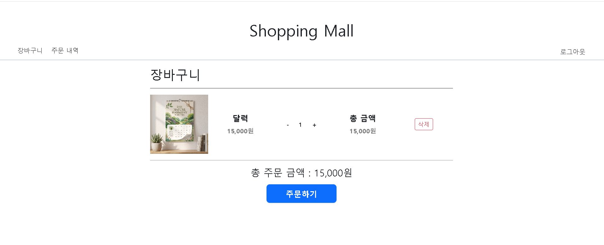

# [트러블 슈팅] 장바구니 상품 수량 변경 시 API 과호출 및 요청 순서 역전 문제 해결 (Debounce 적용 및 버튼 제어)

# 1. 배경



**장바구니 페이지**

- 장바구니 페이지에서 사용자가 담은 상품의 수량을 조절(+ / - 버튼)할 수 있는 기능을 구현을 목표로 합니다.
- 요구사항 및 기대 동작
  - **UI 즉각 반영** : 사용자가 수량 조절 버튼을 클릭하면 클라이언트 화면상의 수량 및 금액 등이 즉시 갱신되어야 합니다.
  - **서버 데이터 동기화** : 변경된 수량은 fetch api를 통해 비동기 요청으로 전달되어 DB의 장바구니 데이터에 정상적으로 반영되어야 합니다.

# 2. 문제 상황

- **API 과호출 및 서버 부하**
  - 사용자가 수량 버튼을 빠르게 연속 클릭할 때마다 매번 요청이 발생하여 불필요한 네트워크 트래픽과 DB I/O 부하가 발생할 수 있었습니다.
- **비동기 요청 순서 역전 (Race Condition)으로 인한 데이터 불일치**
  - 최종 결정된 수량을 서버로 전송하여 DB에 반영하는 방식의 경우, 연속된 요청 간 네트워크 지연 시간 차이로 인해 늦게 보낸 요청이 먼저 처리되고 이전 요청이 뒤늦게 처리되는 순서 역전 현상이 발생할 수 있었습니다.
  - 결과적으로 클라이언트 UI에는 최신 수량이 표시되지만, DB에는 과거 요청의 수량이 덮어씌워져 데이터 불일치 문제가 발생할 수 있었습니다.

# 3. 원인 분석

- **이벤트 기반 즉각 요청 구조 (API 과호출 원인)**
  - 사용자의 버튼 클릭 이벤트마다 API 호출 로직이 즉시 트리거되는 1:1 바인딩 구조로 인해, 연속 입력 시 불필요한 네트워크 트래픽과 서버 연산이 그대로 발생함
- **비동기 요청에 대한 동시성 제어 부재 (순서 역전 원인)**
  - 이전 요청의 진행 여부와 관계없이 후속 요청을 계속 발송하고, 응답 도착 순서나 상태 갱신 순서를 제어하는 로직이 구현되어 있지 않았음

# 4. 해결 방법

- 사용자 경험(UX)을 해치지 않으면서API 과호출과 순서 역전 문제 해결을 위해 다음 전략을 구현
  1. UI 낙관적 업데이트
  2. 상품별 독립 Debounce 적용
  3. 통신 중 버튼 비활성화(Lock)

#### 1. 이벤트 위임 및 UI 낙관적 업데이트

- document에 클릭 이벤트를 위임하여 이벤트 타겟이 + / - 버튼인 경우 이벤트 처리 로직 실행
- 사용자가 버튼을 클릭하면 서버 응답을 기다리지 않고 화면의 수량과 총 상품 가격과 전체 상품 가격의 합을 갱신한다.
- UI 갱신 후 scheduleQuantityUpdate()를 호출하여 디바운스 스케줄링을 시작한다.

```jsx
// 이벤트 위임, 수량 +, - 버튼 처리
document.addEventListener("click", (e) => {
  const isPlus = e.target.classList.contains("btn-increase");
  const isMinus = e.target.classList.contains("btn-decrease");

  if (!isPlus && !isMinus) return;

  const row = e.target.closest(".cart-item-row");
  if (!row) return;

  const input = row.querySelector(".item-quantity-input");
  let currentQty = parseInt(input.value, 10) || 1;

  if (isPlus) {
    currentQty += 1;
  } else if (isMinus) {
    if (currentQty <= 1) return;
    currentQty -= 1;
  }

  input.value = currentQty;
  updateItemTotalPrice(row); // 하나의 장바구니 상품 총 합 가격 업데이트
  updateTotalOrderPrice(); // 장바구니 전체 상품 총 합 가격 업데이트

  scheduleQuantityUpdate(row, currentQty, 500);
});
```

#### 2. 아이템별 독립 Debouce 스케줄러 구현 (API 과호출 방지)

- debounceTimers를 Map 자료구조로 선언하여 각 장바구니 상품(cartId)마다 타이머를 독립적으로 관리한다.
- 특정 상품의 수량을 연속으로 조절하면 이전 timeId를 clearTimeout으로 취소하고 마지막 입력 후 delay 시간 동안 추가 조작이 없을 때만 단 1회 서버 동기화 요청을 전송한다.

```jsx
// 디바운스 스케줄러
function scheduleQuantityUpdate(row, targetQuantity, delay = 500) {
  const cartId = row.dataset.cartId;
  if (!cartId) return;

  if (debounceTimers.has(cartId)) {
    clearTimeout(debounceTimers.get(cartId));
  }

  const timerId = setTimeout(() => {
    sendQuantityUpdateRequest(row, cartId, targetQuantity);
    debounceTimers.delete(cartId);
  }, delay);

  debounceTimers.set(cartId, timerId);
}
```

#### 3. 버튼 비활성화 및 롤백 처리 (요청 순서 역전 방지 & 데이터 불일치 방지)

- 실제 fetch API 통신이 시작되면 해당 상품의 + / - 버튼을 즉시 비활성화하여 네트워크 요청 중에 새로운 입력이 들어가는 것을 방지하고 응답이 도착하였을 때 finally 블록에서 버튼을 다시 활성화하여 요청이 한번에 하나씩만 가도록 하여 요청 순서 역전(Race Condition)을 방지한다.
- 통신 실패 시 catch 블록에서 rollbackToLatesServerState()를 호출하여 UI를 서버의 실제 데이터 상태로 복구한다.

```jsx
// 비동기 수량 변경 요청
async function sendQuantityUpdateRequest(row, cartId, quantity) {
  const buttons = row.querySelectorAll(".btn-increase, .btn-decrease");

  setButtonsDisabled(buttons, true);

  try {
    const response = await fetch("/carts/update", {
      method: "POST",
      headers: {
        "Content-Type": "application/json",
        ...getCsrfHeaders(),
      },
      body: JSON.stringify({
        cartItemId: cartId,
        quantity: quantity,
      }),
    });

    if (!response.ok) {
      const errorData = await response.json().catch(() => ({}));
      throw new Error(errorData.message || "수량 변경에 실패했습니다.");
    }

    const data = await response.json();

    if (data && typeof data.quantity === "number") {
      row.querySelector(".item-quantity-input").value = data.quantity;
    }

    updateItemTotalPrice(row);
    updateTotalOrderPrice();
  } catch (error) {
    console.error("수량 갱신 오류:", error);
    alert(
      error.message || "수량 변경 중 문제가 발생하여 원래 상태로 복구합니다.",
    );

    await rollbackToLatestServerState(row, cartId);
  } finally {
    setButtonsDisabled(buttons, false);
  }
}

function setButtonsDisabled(buttons, isDisabled) {
  buttons.forEach((btn) => {
    btn.disabled = isDisabled;
    btn.classList.toggle("opacity-50", isDisabled);
  });
}
```

# 5. 결과

- **API 호출 횟수 대폭 감소 및 서버 부하 완화**
  - 연속적인 클릭 이벤트 중 마지막 입력 후 500ms가 지난 시점에만 단 1회의 요청을 발송하도록 최적화하여, 불필요한 네트워크 트랙픽과 DB I/O부하를 크게 줄였다.
- **비동기 요청 순서 역전 방지를 통한 데이터 정합성 확보**
  - 실제 통신 진행 구간 동안 해당 상품의 조절 버튼을 비활성화하여 중복 요청 발행 및 네트워크 요청 역전 현상(Race Condition)을 차단하였다.
- **예외 상황에 발생 시 클라이언트 UI와 DB 데이터 불일치 방지 및 복구(Rollback) 매커니즘 구축**
  - 네트워크 장애나 서버 비즈니스 로직 예외 발생 시, DB의 최신 수량 데이터를 기반으로 UI를 원상 복구하여 클라이언트와 서버 간 데이터 불일치를 방지했다.

# 6. 회고

초기 설계 단계에서는 단순히 “버튼을 누르면 비동기로 DB 수량을 갱신한다.”는 단순한 흐름으로 접근했다. 하지만 실제 구현 과정에서 네트워크 지연, 연속적인 사용자 입력으로 인한 비동기 요청 순서 역전, UI와 서버 간 데이터 불일치 등 다양한 예외 상황과 마주하게 되었다.

이를 통해 겉으로 단순해 보이는 기능이라도 시스템의 안정성과 높은 사용자 경험(UX)을 보장하려면 보이는 것보다 훨씬 많은 엣지 케이스와 동시성 제어를 고려해야 한다는 점을 깊이 체감했다.

앞으로 기능을 설계하고 구현할 때는 시스템이 견고하고 동작할 수 있도록 더 넒은 시야에서 깊이 있게 고민하고 설계하는 태도를 가져야 한다는 것을 알게 되었다.
