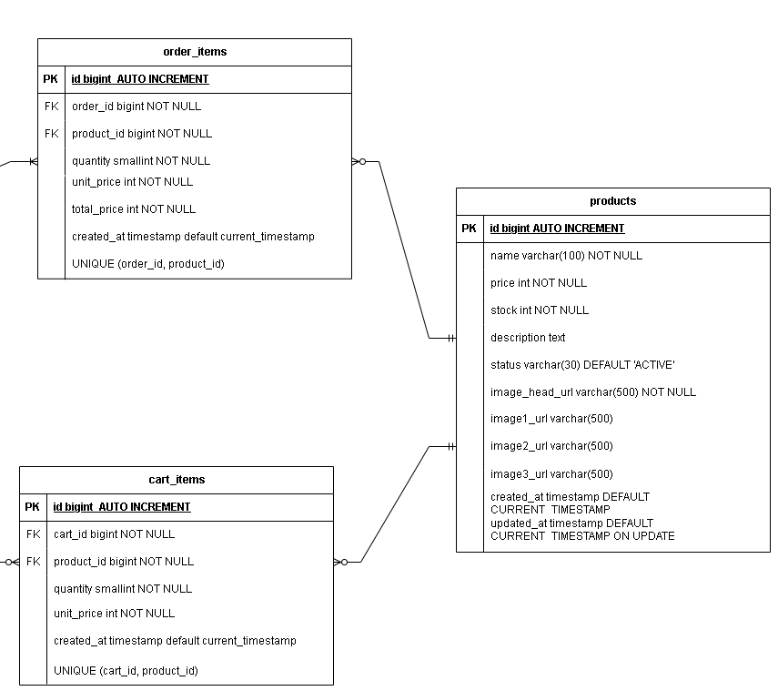

# [트러블 슈팅] 참조 무결성 제약 조건을 고려한 상품 삭제 기능 구현 (Soft Delete 도입)

# 1. 배경

### 상황

- 스프링 부트 기반 쇼핑몰 프로젝트에서 관리자용 상품 삭제 기능 구현 진행

### 기존 계획

- 상품 ID를 받아 데이터베이스에서 해당 레코드를 완전히 삭제하는 Hard Delete 방식으로 설계

# 2. 문제 상황

- 기존 계획대로 상품 삭제 기능을 Hard Delete로 진행했을 경우, 향후 구현할 주문 도메인 기능 구현 후 삭제를 진행할 때, 주문 이력이 있는 상품은 삭제 되지 않고 데이터베이스 레벨에서 예외 발생한다.

#### 발생 예외

DataIntergrityViolationException (외래키 참조 무결성 제약조건 위배)

# 3. 원인 분석

- 상품(Products) 테이블이 주문 상품(Order_Items) 테이블과 장바구니(Cart_Items)과 각각 1:N 연관 관계를 맺고 있으며, 외래키(FK) 제약 조건이 설정되어 있음

#### ERD



# 4. 해결 방법

#### 상품 상태 ENUM 추가

```java
public enum ProductStatus {
    ACTIVE("판매중"),
    INACTIVE("판매종료"),
    DELETE("삭제");

    private final String description;

    ProductStatus(String description) {
        this.description = description;
    }

    public String getDescription() {
        return description;
    }
}
```

- ProductStatus.DELETE 상태 추가

#### 상품 상태 변경을 통해 삭제 기능 구현 (서비스 레이어)

```java
//상품 삭제 상태 변경
    @Transactional
    public void softDeleteProduct(Long productId) {
        Product product = productRepository.findById(productId).orElseThrow(() -> new IllegalArgumentException("존재하지 않는 상품입니다."));
        product.setStatus(ProductStatus.DELETE);
    }
```

#### 상품 조회 코드

**일반 유저용 상품 목록 조회**

```java
// 리포지토리 계층, 스프링 데이터 JPA
Page<Product> findByStockGreaterThanAndStatus(
            int stock,
            ProductStatus status,
            Pageable pageable
    );
```

```java
// 서비스 계층
// 상품 목록 (일반 유저용) 조회
    @Transactional(readOnly = true)
    public Page<ProductListDto> getProductList(Pageable pageable) {
        return productRepository.findByStockGreaterThanAndStatus(1,ProductStatus.ACTIVE, pageable).map(this::mapToProductListDto);
    }
```

- 상품 상태가 ProductStatus.ACTIVE인 상품만 상품 목록에서 조회됨

**관리자용 상품 목록 조회**

```java
// 리포지토리 계층, 스프링 데이터 JPA
Page<Product> findByStatusNot(ProductStatus status, Pageable pageable);
```

```java
// 서비스 계층
// 관리자 상품 목록 리스트
    @Transactional(readOnly = true)
    public Page<AdminProductListDto> getAdminProductList(Pageable pageable) {
        return productRepository.findByStatusNot(ProductStatus.DELETE, pageable).map(this::mapToAdminProductListDto);
    }
```

- 상품 상태가 ProductStatus.Delete가 아닌 상품만 상품 목록에서 조회됨

# 5. 결과

- 주문 이력이 있는 상품도 삭제 요청을 정상 처리할 수 있게 되었다.
- 삭제된 상품은 일반 사용자의 상품 목록 조회에서 조회 되지 않게 되었다.
- 삭제된 상품은 관리자용 상품 목록 조회에서 조회 되지 않게 되었다.
- 주문 데이터의 참조 무결성을 유지하면서 상품 삭제 기능을 구현할 수 있었다.

# 6. 회고 및 예방

**설계 단계의 중요성** : 데이터 삭제 기능을 구상할 때 단순히 해당 테이블만 볼 것이 아니라 데이터의 생명 주기와 참조 관계를 고려해 초기 기획 단계에서 Hard Delete/Soft Delete 여부를 정의해야 함을 깨달음

**영향도 평가** : 데이터 변경 방식을 수정함에 따라 상품 수정, 상품 조회 메서드 등 기존에 작성된 코드를 수정해야 하는 일이 발생 되었기에 변경된 사항으로 인한 사이드 이펙트 관리의 중요성을 깨달음
